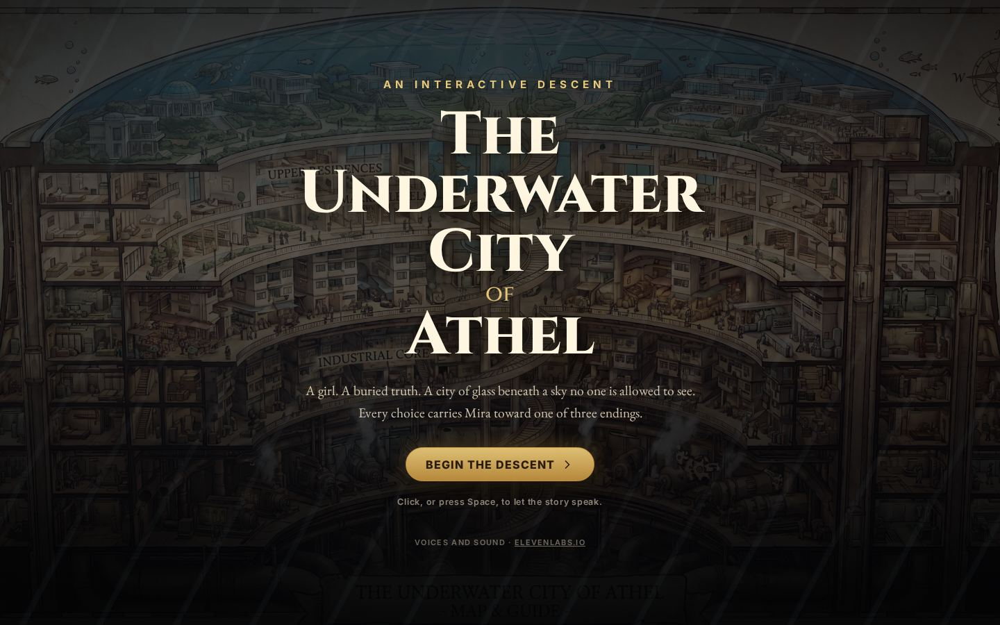
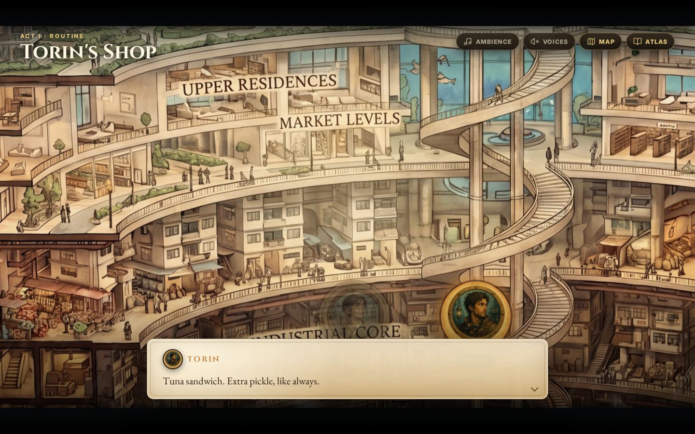
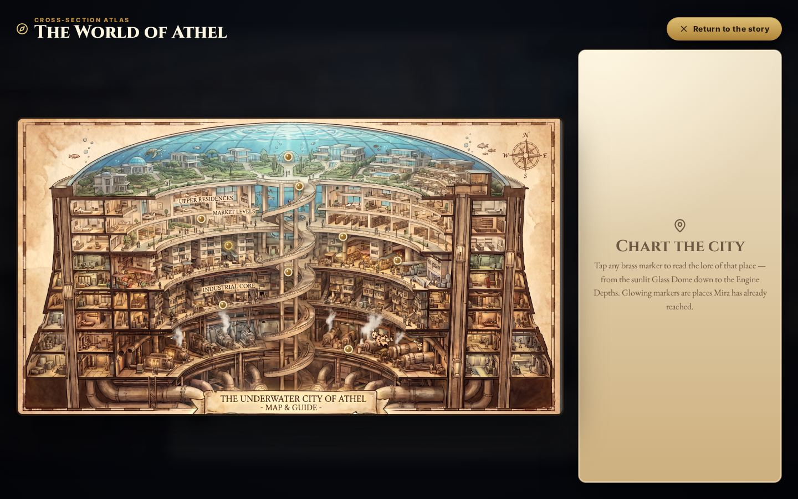

# The Underwater City of Athel

A cinematic choose-your-own-adventure through a sealed city under the sea. The cross-section map is the stage: the camera travels between districts, the cast speaks on the glass, and Mira's choices lead to one of three endings.

**Voices and sound: [elevenlabs.io](https://elevenlabs.io)**

Play it: **[underwater-city-story.vercel.app](https://underwater-city-story.vercel.app)**







## How it was made

The story follows Mira, a student in the Tank, after she finds proof that the poisoned-surface story her city teaches is a lie. The prose began as the drafts in [`story-source/`](story-source). The playable version turns that prose into a scene graph: optional detours rejoin the main path, and the climax branches for real.

The map and the character sheet are original illustrations made for Athel, including AI-generated art by the author. Dialogue, mood beds, and sound effects were pre-rendered with ElevenLabs and committed under `public/audio/`, so the public site plays locally and does not call the API.

## Tech stack

- [React 19](https://react.dev) and TypeScript, bundled with [Vite](https://vite.dev)
- [Framer Motion](https://www.framer.com/motion/) for the camera, travel, and fades
- Vitest and Testing Library for unit tests; Playwright for the ending paths
- A static production build on [Vercel](https://vercel.com)
- [Void](https://void.cloud) for an optional dev-time `/api/eleven` route that keeps an ElevenLabs key on the server

## Quick start

```bash
npm install
npm run dev      # http://127.0.0.1:5173
npm test         # unit tests
npm run lint
npm run build    # void prepare, typecheck, production bundle
npm run e2e      # Playwright (installs a browser on first run)
```

`npm run build` writes `dist/`. Set `STATIC_BUILD=1` to skip the Void plugin and emit the same static site Vercel serves. Vercel sets that mode itself.

Copy `.env.example` to `.env.local` only if you want to regenerate audio. The key name is `ELEVENLABS_API_KEY`. Leave it unset to play the committed clips. The `/api/eleven` route is for that local workflow. The public site is the static build, which never receives the key.

```bash
npm run audio    # re-render missing voice, music, and effect files
```

## Playing

Each scene offers choices. Some collect clues; the climax splits into different endings. Four hidden traits — evidence, trust, risk, and collective — decide the finale:

- **Hopeful** — proof, allies, and a public that can hear it.
- **Bittersweet** — the truth spreads faster than anyone can hold it.
- **Dark** — an escape with too little proof and no one beside her.

The map overlay opens the whole cross-section. The atlas keeps collected items, the cast, and achievements. An in-progress run is saved in the browser and can be continued from the title screen.

## Credits

- Story, illustrations, and code by [Adam](https://github.com/Programcode).
- Cinzel, EB Garamond, and Inter are loaded from Google Fonts. Each is licensed under the [SIL Open Font License](https://openfontlicense.org/).
- Voice, music beds, and sound effects: ElevenLabs. Details and the free-plan limits are in [`public/audio/CREDITS.md`](public/audio/CREDITS.md).

## Licence

Source code is [MIT](LICENSE), copyright 2026 Adam.

The MIT license stops at the code. The story prose in `story-source/` and `src/data/`, the illustrations in `public/assets/`, and the audio in `public/audio/` stay under the terms in the credits above. The prose and illustrations are the author's, all rights reserved, and are included so the project can be read and run.
